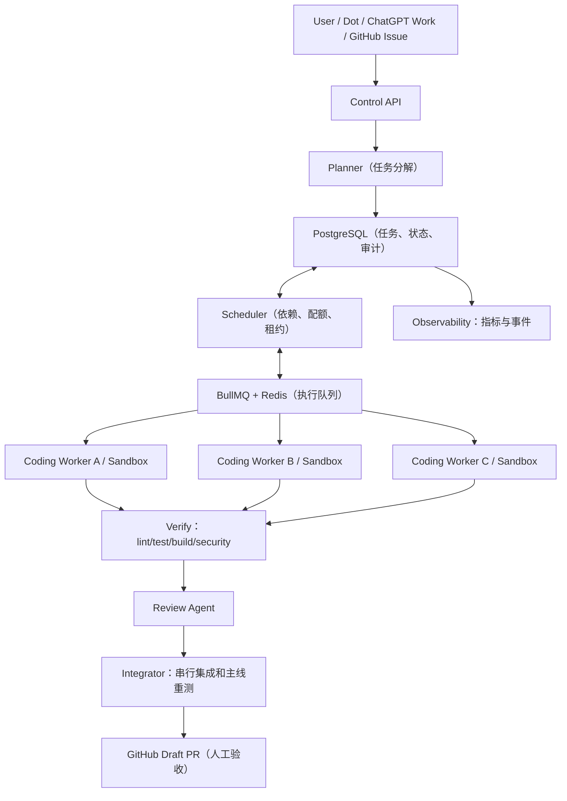

# Agent Factory：多 Agent 自动软件开发流水线（架构与实施计划 v0.1）

> 状态：规划草案；尚未部署或开始编码。
> 日期：2026-10-13。
> 项目目标：将一条 GitHub Issue / 自然语言需求，稳定转化为可审核的代码 PR、测试报告和执行记录。
> 存放位置：临时放在 count-back/claude-config 的独立文档分支中。最终实现应建立独立仓库 count-back/agent-factory；本文件应迁移到新仓库并持续作为项目事实来源（source of truth）。

## 1. 核心目标与边界

交付一个“你提出需求 -> AI 规划 -> 多 Worker 并发开发 -> 自动验证 -> 生成 PR -> 人工验收”的闭环。

首个可用版本（MVP）的验收场景：

1. 接收一个指向测试仓库的 GitHub Issue 或手动提交的任务请求。
2. Planner 将需求拆解成带依赖关系、改动范围和验收标准的任务 DAG（有向无环图，表示任务执行的先后依赖关系）。
3. Scheduler 最多并行派发 3 个独立 Coding Worker；每个 Worker 运行在单独工作目录/容器和 Git 分支中。
4. Worker 修改代码并运行允许的测试，生成日志与 diff。
5. 失败的任务有限次数重试；通过验证的任务交给独立 Review Worker。
6. 集成层串行合并候选更改到待评审分支，重新运行集成测试，创建 GitHub Draft PR。
7. 在 PR 中提供任务来源、变更摘要、测试记录、已知风险和人工验收清单；不自动合并或部署。

明确非目标：
- MVP 不追求 10、50、100 Agent 的名义并发，也不承诺 24 小时无额度限制地执行。
- 不做生产环境自动部署、自动付费、删除重要资源、自动合并主分支。
- 不允许多个 Writer 在同一工作树中同时任意写文件。
- 不为第一版引入 Kubernetes、复杂多模型路由、真正自主的产品决策循环或重写现有工具。

## 2. 与现有仓库的关系

- [count-back/claude-monitor](https://github.com/count-back/claude-monitor)：已有 Claude Code JSONL 日志采集、Session/Agent/Tool 统计及 SQLite 数据。后续可复用报表设计，新增 Codex Runner 的指标采集，但不要让调度服务直接依赖它的本地 SQLite 文件。
- [count-back/claude-config](https://github.com/count-back/claude-config)：已有配置模板、项目配置与 AGENTS.md/CLAUDE.md 生成能力，可在未来作为 Agent 规则模板库；当前应用数据使用 ~/.claude/monitor.db。Agent Factory 的调度库必须与这个 SQLite 文件分离。
- 独立仓库建议命名 count-back/agent-factory。只有在用户确认创建/提供仓库之后，才迁移本计划或落地代码；不要把业务实现直接塞进 claude-config。

## 3. 逻辑架构



### 技术选型（MVP）

- TypeScript + Node.js LTS + pnpm。
- HTTP 控制 API：Fastify，输入输出由 Zod 校验。
- 编排与重试：BullMQ + Redis；业务状态及幂等性：PostgreSQL。
- AI 执行器抽象：AgentRunner 接口；首个适配器用 Codex CLI/SDK，后续可选 Agents API 与其他编码 Agent。实现时必须对照当时的官方 SDK/CLI 文档确认参数。
- GitHub 集成：最低必要权限的 GitHub App / Octokit，或原型期使用隔离的仓库专用凭据；PR 默认 Draft。
- 代码执行：每任务独立临时 Git clone + Docker Sandbox（网络出口限制、非 root、只挂载必要目录、资源配额）；本地实验可先用 Git worktree，但 worktree 本身不是安全边界。
- 测试：Vitest + 针对样例仓库的真实 lint/build/test 命令。GitHub Actions 负责 PR 质量门禁。
- 监控：先落库任务事件、费用和运行时长，后续接 OpenTelemetry / Grafana。

## 4. 服务模块与接口

建议 monorepo 目录结构：

```text
apps/
  api/                 # 任务提交、查询、审批和回调
  worker/              # Worker 主进程：拉取、运行、上报
packages/
  contracts/           # Task、Run、Event 类型和 Zod schema
  planner/             # 需求分析、拆分、依赖校验
  scheduler/           # DAG-ready 检测、全局并发、配额、租约
  agent-runner/        # AgentRunner 接口与 Codex Adapter
  sandbox/             # 临时 clone、容器创建/销毁、资源控制
  verifier/            # lint/test/build、安全扫描、验收
  github/              # Issue/PR/commit/status API
  integrator/          # 单线程候选合并、冲突处理、全量 CI
  telemetry/           # token、耗时、费用、错误、事件
infra/
  docker-compose.yml   # 仅本地开发环境
docs/
  architecture.md
  runbook.md
```

核心抽象：

```ts
interface AgentRunner {
  run(input: {
    jobId: string;
    instruction: string;
    workspacePath: string;
    timeoutSeconds: number;
    maxBudgetUsd: number;
  }): Promise<{
    exitCode: number;
    logArtifact: string;
    summary: string;
    usage?: { inputTokens?: number; outputTokens?: number };
  }>;
}
```

注意 maxBudgetUsd 是**编排层强制执行的预算**，不意味着所有 Agent SDK 都原生支持该参数。

## 5. 任务契约

每个独立 Coding Task 必须包含明确的作用域、依赖、基线和完成判据：

```json
{
  "job_id": "AF-001",
  "project_id": "demo",
  "repo": "owner/repo",
  "base_sha": "<actual-commit-sha>",
  "title": "Implement health endpoint",
  "description": "Add GET /health and tests",
  "depends_on": [],
  "write_scope": ["apps/api/**", "tests/**"],
  "acceptance": ["pnpm test", "pnpm lint"],
  "max_attempts": 2,
  "max_runtime_sec": 2700,
  "max_budget_usd": 5,
  "idempotency_key": "demo:issue-123:health-v1"
}
```

关键规则：

- Planner 必须先输出 JSON Schema 校验过的 DAG，再派发代码执行；所有依赖 ID 必须存在，且无环。
- 允许并行的任务应尽量文件范围互斥；共享代码修改拆成前置任务，或显式串行执行。
- Git 基线使用真实 SHA，不可只依赖浮动分支名。
- write_scope 由服务端检查实际 diff；不能只在 Prompt 中声明。
- 所有来源于 Issue、仓库文件及 Agent 输出的内容均是低信任输入，不得覆盖运行器的权限策略。
- job_id + attempt_id + git commit SHA 组成可审计的运行上下文。

## 6. 生命周期与持久化

任务状态：PLANNED -> READY -> RUNNING -> VERIFYING -> REVIEWING -> PR_OPEN -> DONE；
失败进入 RETRY_WAIT / FAILED / BLOCKED / NEEDS_HUMAN。

PostgreSQL 最小表：
- projects：仓库、默认分支、权限策略、预算。
- jobs：任务契约、状态、DAG 关系、版本与幂等键。
- job_dependencies：父子依赖边。
- attempts：实际运行次数、worker_id、时间、退出码、sandbox_id、lease_until。
- events：状态变更、审计、错误、审批；按 job/attempt 关联。
- artifacts：日志、diff、测试结果、PR URL、校验和。
- approvals：需要人工授权的事项和处理结果。

消息队列不是真相来源。更新数据库状态及发消息应使用事务 outbox 或等效的幂等重放策略。Worker 通过租约/心跳维持占用；异常退出后任务能够重新进入待调度状态，并保证不会重复提交 PR。

## 7. 并发和失败策略

MVP 默认：
- CODING_CONCURRENCY=3
- INTEGRATION_CONCURRENCY=1（每仓库）
- REVIEW_CONCURRENCY=1
- MAX_ATTEMPTS=2
- MAX_RUNTIME_SEC=2700
- MAX_SUBAGENTS_PER_JOB=0（先不开放任务内部并发写入）

真实允许并发 = min(账户/模型配额、可用 CPU/内存、任务可并行度、预算/安全上限)。
支持按 provider / repo / project 限流、429 退避重试、任务超时、中止与手工继续。任务重试必须重新评估 base_sha 与写入冲突；不能盲目复用过期工作目录。

每个任务通过隔离 Sandbox 执行；验证和审查不在 Agent 的自述中“判定通过”，而由实际命令退出码、可信的 CI 状态和独立验收器判断。

## 8. 安全与审批

- Agent 容器默认无生产密钥、无宿主 Docker socket、非 root；限制网络出口并为 CPU、内存、磁盘、时间配置配额。
- 仓库权限遵守最小权限；优先由控制层代理 GitHub 写操作。Fork/外部 PR 的代码不能获得写令牌。
- 禁止生产部署、资金操作、销毁云资源、修改权限策略；这些必须人工授权。
- 默认只创建 Draft PR；不自动向主分支推送、不自动合并。敏感模块（支付、鉴权、迁移）要求额外人工审查。
- 日志对 Token、个人信息、密钥和环境变量进行脱敏；保留必要审计记录，设置保留期限。
- 对依赖下载、测试脚本和动态运行命令实行沙箱隔离；Prompt 不构成安全边界。

## 9. 端到端交付流程

1. Control API 接收 Issue / API 输入，持久化原始任务及用户指定的目标仓库。
2. Planner 输出包含 DAG、write_scope、验收命令、估计预算的计划；不确定时进入 NEEDS_HUMAN。
3. Scheduler 找出就绪任务，检查限额，排队并分配独立 Sandbox。
4. Worker 基于固定 SHA clone，运行 Codex，保存事件日志，检查 diff 范围，并执行任务级验证。
5. 失败 -> 附错误日志有限次数修复；超预算/重试上限 -> NEEDS_HUMAN。
6. Review Agent 检查 diff、测试证据、潜在越权改动；审查未过返回修复或阻断。
7. Integrator 串行集成到候选分支，针对最新主分支重新验证；冲突交给受限修复任务。
8. 创建 Draft PR，包括原始 Issue、任务清单、验收日志、运行成本、待人工检查点。
9. 用户明确审核、合并；系统记录结果与交付周期。

## 10. 开发顺序与分阶段验收

### Phase 0 — 单一仓库脚手架
- [ ] 创建独立仓库 agent-factory，并从此规划分支迁移 docs。
- [ ] 搭建 Node/TS monorepo、Docker Compose（PostgreSQL、Redis）、基础 CI、.env.example（不含真实密钥）、README。
- [ ] 输出 ADR-001（技术选型及不选 Kubernetes 的原因）。
- [ ] 本地一条命令启动依赖，测试通过。

### Phase 1 — 3 个隔离 Coding Worker
- [ ] 实现 AgentRunner 接口及 CodexAdapter，支持命令执行、超时、取消、事件日志。
- [ ] 实现 SandboxManager：隔离 clone、分支、资源限制、清理。
- [ ] 基于 3 个互不冲突的小任务做并行实验。
- [ ] 实测并发=3 时工作目录互不污染；失败能被记录。

### Phase 2 — 调度与恢复
- [ ] PostgreSQL 任务模型、迁移及状态机。
- [ ] BullMQ 调度、依赖就绪检测、幂等入队、租约/恢复。
- [ ] 每项目并发、全局并发、预算和超时限额。
- [ ] 单元/集成测试：DAG 有环、不满足依赖、重复投递、Worker 崩溃、超时、429。

### Phase 3 — 自动验证与 PR
- [ ] 执行 lint/test/build，并保存机器可读结果。
- [ ] 实现 write_scope 检查、独立审查和限定次数修复。
- [ ] 串行 Integrator、主分支基线刷新、冲突处理和 Draft PR。
- [ ] PR 汇总原始需求、测试结果、变更、风险与费用。
- [ ] GitHub branch protection / CI 状态门禁，人工合并。

### Phase 4 — 度量和演进
- [ ] 导出统一事件和使用量指标，按 job / attempt / agent 聚合。
- [ ] 后续与 claude-monitor 的可视化集成（不共享调度数据库）。
- [ ] 可选引入 claude-config 的规则模板（通过接口或文件导入）。
- [ ] 对固定任务集测试并发 1/3/6，比较合格 PR 产出、时长、失败率及成本。
- [ ] 在确有瓶颈时再引入 Agents API、多模型路由、Temporal、Kubernetes。

## 11. 交付验收（Definition of Done）

- 能够从一个明确需求产生一个 Draft PR；PR 含真实 CI/本地测试证据，而非模型声称。
- 3 个 Worker 的文件系统、Git 分支和凭据隔离。
- Worker 崩溃后不会丢任务，不重复提交 PR。
- 有超时、失败重试、人工阻断和紧急停止。
- 预算阈值可执行；能够记录每个任务的 Token、时长、费用（若供应商提供）。
- 不发生主分支自动合并、生产部署、敏感凭据泄露。
- README 可指导另一名开发者从零启动并复现实例。

## 12. 需要用户决策的事项

- 目标仓库：建议新建 count-back/agent-factory；此仓库中的规划只是临时暂存。
- 首个试验项目：建议新建或选择无生产凭据的 Demo Repo，而不是直接拿真实核心业务项目测试。
- AI 运行凭据和额度：由用户在隔离的本地/云端环境配置，不能写进仓库或 Issue。
- 成功后是否允许自动合并：默认否，单独评审后再议。

## 13. 交给 Dot / ChatGPT Work / Codex

从同目录的 [START_HERE.md](./START_HERE.md) 复制启动指令。执行 Agent 的第一项任务是：阅读本规划，检查实际工具/API/配额，建立独立 agent-factory 仓库及 Phase 0 脚手架；遇到权限或创建仓库限制时报告阻塞，不擅自把实现代码写进 claude-config。

记录进度的权威位置应始终是 GitHub Issue/PR 和已提交文档，而不是某个聊天窗口的隐含上下文。